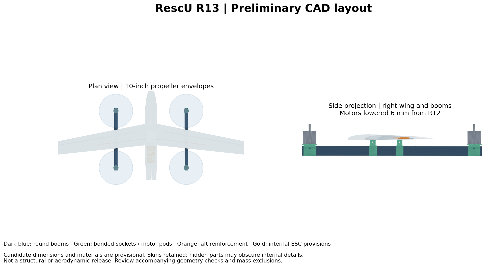
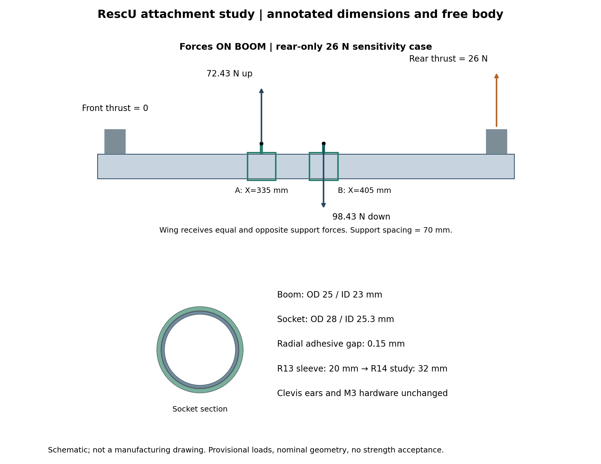

# RescU Structures — R13 layout / R14 attachment development

**R13 is the reviewed layout candidate. R14 is a separate socket-overlap study. Neither is strength-qualified.** The older V4 / CAD P03 analysis remains available as a historical checkpoint; its mass, CG and structural results do not describe R13/R14.

## Current progress

- R13: longer round motor booms, motors lowered 6 mm, separate bonded motor pods/wing sockets, extended aft reinforcement and internal ESC provisions.
- R13 geometry check: 143 targeted candidate pairs; no reported intersections over 0.01 mm³ and no invalid checked shapes. Scope excludes a full unchanged-assembly audit and loaded clearance.
- R14: wing-socket sleeve overlap 20 → 32 mm; four modified solids valid and 20 targeted pairs clear. Modeled mass addition 8.68 g before adhesive; no change to bolt spacing or motor locations.
- Attachment study: force/moment equilibrium, provisional 17.3 N thrust cases, separate 26 N / 0.45 N·m sensitivity, and nominal bolt/rib/ear demand calculations.
- Component register: 250 CAD feature locations and 29 equipment/accounting entries. Unknown masses/positions prevent release of an aircraft CG.
- Material/process candidates: matching 25/23 mm carbon tube, vacuum-bagged laminate trials and adhesive characterization plan. Diego confirms vacuum bagging available; no materials purchased/committed.

## Read first

| Document | Purpose |
|---|---|
| [Latest progress and downloads](docs/CURRENT_STATUS.md) | Revision status, package access and limitations |
| [Attachment study](reports/connection_study/START_HERE.md) | Free body, calculations, R14 trade and placement plan |
| [Material, bond and twist basis](requirements/MATERIAL_BOND_TWIST_CANDIDATES.md) | Supplier-backed candidates and qualification plan |
| [Load basis](requirements/LOAD_BASIS.md) | Equations, assumptions and missing operating inputs |
| [Team input requests](requirements/TEAM_DATA_REQUESTS.md) | Responsibilities and prioritized questions |
| [Task board](docs/TASK_BOARD.md) | Completed screens and remaining gates |
| [CAD baseline and distribution](cad/BASELINE.md) | Provenance, file hashes and assembly download links |





## Run calculations

Python 3.10+ standard library, from the repository root:

```powershell
python analysis/r13/arm_load_screen.py
python analysis/r13/attachment_calculations.py
python analysis/r13/material_candidate_screen.py
python analysis/r13/cg_from_register.py
```

The CG script deliberately exits with an incomplete-inventory message until every required mass and location is resolved. CAD centroids are geometric placement proxies, not measured equipment CGs. Preserve proposed/assumed labels when filling the register.

`arm_load_screen.py` writes `results/r13/`, which remains ignored; reviewed snapshots are committed under `reports/r13/`. `attachment_calculations.py` regenerates the initial candidate register as well as calculations: back up any manually completed register before rerunning it, or pass that working register directly to `cg_from_register.py`. `material_candidate_screen.py` writes its candidate result under `requirements/`.

## CAD and drawings

The smaller added-parts STEP exports are directly committed under `cad/r13/` and `cad/r14_socket_study/`. Full native assemblies and the large assembly STEP are supplied in the versioned packages linked from [the CAD manifest](cad/FILE_MANIFEST.md). Package links require access to Diego's ChatGPT account; they are not public team downloads. An ordinary clone does not contain the full native assemblies.

Download/extract the relevant package and place its native files at the paths in the manifest to reproduce CAD work. FreeCAD Python with `FreeCAD` and `Part` is required for CAD scripts; the checker also needs NumPy/Shapely, and review drawings need Matplotlib. Example Windows path:

```powershell
& 'C:\Program Files\FreeCAD 1.1\bin\python.exe' cad/scripts/build_r14_socket_study.py
```

This consumes the R13 native file under `cad/r13/` and creates a separate R14 study. `build_r13.py` additionally requires the exact preserved R12 native source supplied as its first argument. See [R13 review](docs/R13_REVIEW.md) and [manufacturing concept](manufacturing/R13_MANUFACTURING.md).

## Remaining engineering work

Resolve lift motor voltage/propeller operating point; reconcile current aircraft mass/CG; establish material/process allowables and bond performance; obtain aero/control stiffness acceptance; analyze actual wing/rib/root compliance; perform FEA and representative tests. The inherited load factors, 1.5 ultimate multiplier and twist/deflection screens remain provisional. Material candidate axial data does not establish laminate bearing, compression or torsional capacity.

## Historical V4 / P03 checkpoint

The original `RescU_Structures_V4.py`, `inputs.json`, `data/cad_snapshot.json`, engine, verification script and [baseline outputs](reports/baseline/SUMMARY.md) remain preserved. Read [the V4 guide](docs/STRUCTURES_V4_GUIDE.md) before reproducing that older configuration:

```powershell
python RescU_Structures_V4.py
python verify_v4.py
```

The scripts and results under `archive/r07_r08/` are historical studies with separate assumptions; their required native inputs are not included in an ordinary clone. They are not R14 FEA validation.

## Update your laptop

In GitHub Desktop, select `rescu-structures`, switch to `main`, then **Fetch origin → Pull origin**. Download native CAD separately using the manifest. Qualification status is recorded separately from progress.
