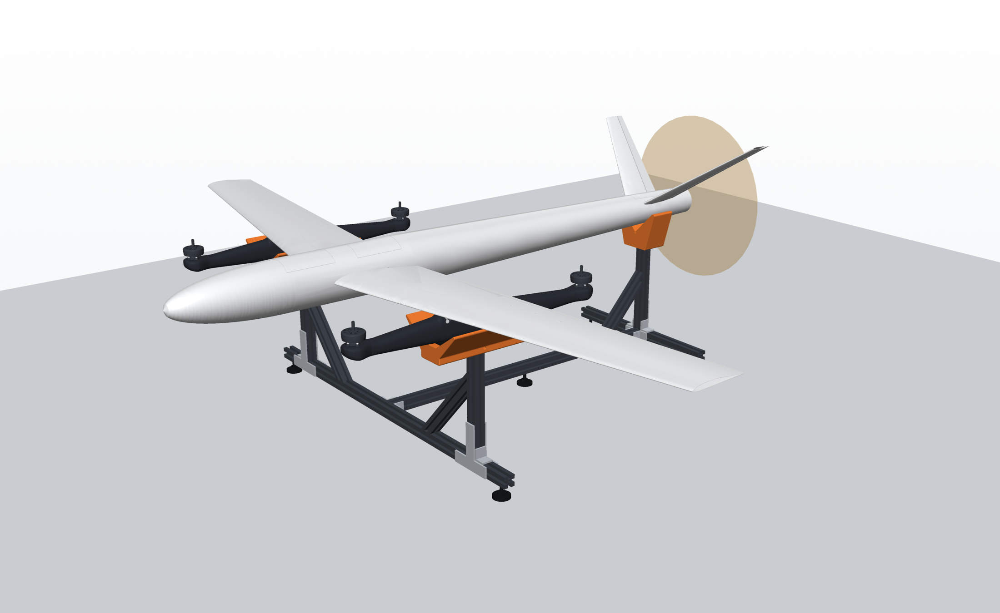

# RescU landing station (November 15, 2026)

Ground station the R16 aircraft lands on vertically. Two flared printed cradles hold the motor booms at mid-boom (under the motor-rib/spar joint), a printed V-rest holds the tail at the F990 frame. 2020 aluminium frame on five leveling feet.

**Build instructions:** [manufacturing/LANDING_STATION_MANUFACTURING.md](../../manufacturing/LANDING_STATION_MANUFACTURING.md)

| Item | Value |
|---|---|
| Pusher-prop tip to ground (seated) | **134.9 mm (5.31 in)** — requirement ≥ 5 in |
| Fuselage centreline / boom bottoms (seated) | 300 / 257 mm above ground |
| Footprint | 640 × 700 mm; ≈ 2.3 kg |
| Capture range | ±45 mm at booms, ±40 mm at tail, ±3.8° heading |
| Load share | booms ≈ 96 %, tail ≈ 4 % |

| File | Content |
|---|---|
| `RescU_Landing_Station.step` | Station assembly (Z up from ground; aircraft CAD sits at Z + 300). SHA-256 `bbf5808aa012ff2a6ad94f5a1ece9c77643495361d099c53f3f5d26dd20b1649` |
| `STL/Cradle_Boom_PETG_print_x2.stl` | Boom cradle, print 2 (print orientation) |
| `STL/Cradle_Tail_PETG_print_x1.stl` | Tail V-rest, print 1 |
| `interference_station.json` | Station vs seated R16 and station internal check |
| `renders/` | Seated, station, cradle close-up, side clearance |
| `scripts/` | `build_station.py`, `export_station.py`, `check_station.py`, `render_station.py` |

Seated full assembly with the current aircraft (R16.5): [`cad/r16/RescU_R16_5_Seated_on_Landing_Station.step.zip`](../r16/RescU_R16_5_Seated_on_Landing_Station.step.zip). It has 0 overlaps; the nose camera hangs 152–180 mm above the floor, 224 mm clear of the station.

## Checks (station vs seated R16 CAD)

- 0 overlaps aircraft vs station and station vs station; only the four EVA pads touch the aircraft; no other aircraft part within 2 mm.
- Closest station point to a lift-prop disk edge: 1.9 mm outside (plan view).

## Open items

Precision landing (RTK or beacon) is required for ±40 mm; 135° brace brackets not modelled; print times/masses and M5 torque are estimates; drop test the cradles.
