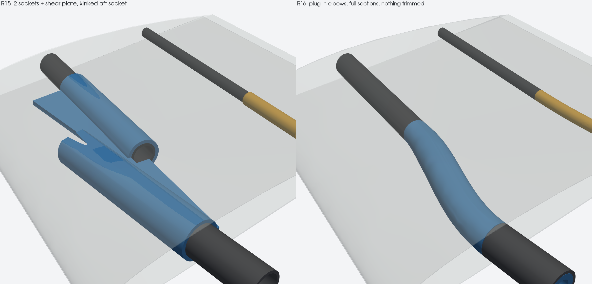

# R16 full-aircraft CAD — current design (R16.2, November 17, 2026)

R16 = R15 + elbow joints at the wing root + TPU landing feet removed (November 15). The aircraft has **no landing gear**; it lands on the [landing station](../landing_station/README.md).

The committed assembly is now **R16.2**:
- **[R16.1](#r161--smooth-nose-pusher-motor-and-propellers-november-16)**: smooth nose, Tarot 4008 pusher and APC propellers.
- **[R16.2](#r162--pusher-mount-and-prop-nuts-november-17)**: motor bolted to the plate, and prop nuts.

The R16 base STEP is still available in git history (commit `9d0ae2d`, STEP SHA-256 `b9ea4e59…0851`).

| File | Content |
|---|---|
| `RescU_R16_Full_Aircraft.step.zip` | **R16.2** full assembly STEP (180.0 MB unzipped; zipped). 112 parts. SHA-256 of the STEP: `30bc1fa921614bf925046f537522d23e7ba10847a94a49f4c007059874be40de` |
| `RescU_R16_BOM_CAD_masses.csv` | CAD mass BOM (R16.2). Motors and props stay in the equipment list, as before |
| `cg.json` | Mass / CG estimate for the R16 base (see [R16.1/R16.2 mass changes](#mass-changes-r161--r162)) |
| `interference_r16.json` | 268 changed-part pairs (0 overlaps > 0.05 mm³) plus every wing tube vs its skin (all 0.000 mm³) |
| `R15_vs_R16_root_joints.png` | Root joint comparison |
| `clearance_r16_1.json`, `clearance_r16_2.json` | R16.1 and R16.2 interference and swept-prop clearance checks |
| `renders/` | Nose before and after, lift props, pusher mount (section, exploded, outside), VTOL prop nut |
| `scripts/` | R16 base: `wing_r16.py` (wing with elbows), `elbow.py` (elbow paths, clearance), `assemble_r16.py`, `check_r16.py`, `cg_r16.py`, `clear.py`, `readstep.py` |
| `scripts/` (R16.1/R16.2) | `nose_r16_1.py` (nose rebuild), `build_props.py` (APC 10x3 / 13x8 models), `place_r16_1.py` / `place_r16_2.py` (motor, props, plate, screws, nuts, shaft extension), `xcaf_r16_1.py` / `xcaf_r16_2.py` (edit the STEP in place: names, colours and sub-assemblies kept), `clearance_r16_1.py` / `clearance_r16_2.py`, `render_r16_2.py`, `vol.py` |

The R16.1/R16.2 scripts use CadQuery/OCP (`pip install cadquery`); the renders also need PyVista. The scripts import the R15 scripts from `../r15/scripts` and the R15 STEP bodies (extracted with `readstep.py`). Paths inside them are the absolute paths of the build machine; adjust before rerunning.

## Changes vs R15

| Change | Detail |
|---|---|
| Root adapter → **root elbow** (CFRP, 10.9 g each, was 13.6 g) | Molded S-bend, OD12 body. Spigot OD9.9 plugs 26 mm into the joiner bore; spigot OD7.9 plugs 30 mm into the OD10/8 spar bore. Tightest bend radius 48 mm. Plugs *into* the tubes, so it is never wider than the joiner. |
| Aft root socket → **aft elbow** (CFRP OD5, 1.69 g) | Single gentle bend; D3 anti-rotation pin bonded in its inboard end; 15 mm spigot into the OD5/3.5 aft torque tube. |
| Joiner | Shortened from ±100 to ±46 mm (wings plug into it). |
| Main spar / aft tube | Start at Y110 / Y100 and butt on the elbow shoulders. Core fills the old shear-plate space. |
| TPU landing feet | Removed (both booms). |

## Checks

- **Nothing trimmed by the skin:** every wing tube has 0.000 mm³ intersection with the skin. Minimum clearance to the inner skin: root elbow 0.66 mm (R15 adapter −1.51, i.e. cut), aft elbow 0.51 mm (was 0.18).
- Interference: 268 pairs involving changed parts, 0 overlaps > 0.05 mm³ (`interference_r16.json`).
- Tight spots unchanged from R15: OD8 spar segment 0.13 mm from the skin at Y560; outboard aft collar 0.17 mm.
- Strength screen (+3 g × 1.5, spar-only, conservative): spar spigot OD7.9/ID4 at Y110 ≈ 317 MPa — make it a solid pultruded CFRP rod or lengthen it.

## Mass and CG

Total 3387.0 g (−33.9 g vs R15). CG x 406.6 mm vs NP 408.0 → static margin +1.0 % MAC. Battery at x ≈ 256 mm reaches the 394.4 mm target CG.

## Landing decision history

1. Removed the TPU feet (this revision).
2. Tried a three-leg gear (raked CFRP legs at mid-boom + tail leg, 135 mm prop clearance): +54.5 g and CG behind the NP (−0.2 % margin). **Dropped.**
3. Folding pusher prop judged not workable by the team.
4. **Adopted: ground landing station** holding the booms and tail — no on-aircraft gear.

## R16.1 — smooth nose, pusher motor and propellers (November 16)

| Change | Detail |
|---|---|
| **Nose strips removed, shape unchanged** | The R16 nose (x 0–200) was 39 conical strips. Each strip corner lies exactly on the ellipse r(x) = 45·sqrt(1 − (1 − x/200)²), skin 0.33 mm (radial). The nose was rebuilt as that exact revolved ellipse, so each shell half now has one smooth outer and one smooth inner face (104 → 28 faces per half). Also rebuilt: `Hatch_Front` (its x 192–200 part) and `Fuselage_Seam_Strips` (0.30 mm under the skin). Boolean check: zero difference for x > 200.5. The only geometric change is the filled facet sag: 2.5 mm at the very tip (the first strip was a pointed cone), < 0.2 mm elsewhere, +0.08 g |
| **Pusher motor: Tarot 4008** | From the vendor STEP (85 g, Ø44.5 × 22, 4 mm shaft, M3 on Ø19 ×4 and Ø32 ×3). Replaced the `REF_MT4008_Envelope` placeholder |
| **`REF_Prop_Adapter_Pusher`** (provisional, 6061) | Ø20 × 3 flange on the rotor, Ø12 seat, 1/4 in shaft. Needed because the Tarot ships with a folding-prop clip, not a shaft for an APC 1/4 in bore |
| **Propellers** | APC Sport models from `build_props.py` (catalog mass matched at 1.35 g/cm³; geometry approximate, fine for mass/CG/clearance, not CFD). The six REF prop disks were removed |

| Position | Prop | Hand |
|---|---|---|
| Front_Boom_R, Rear_Boom_L | 10x3 LP10030 | STD, CCW from above |
| Front_Boom_L, Rear_Boom_R | 10x3 LP10030P | P, CW from above |
| Pusher | 13x8 LP13080P | P (pusher), cambered face forward |

Lift-prop rotation follows the ArduPilot Quad-X convention; swap STD/P if the flight controller layout differs. Lift props sit on the UM2807 bell top (z 8.2), centred on the M5 shaft.

## R16.2 — pusher mount and prop nuts (November 17)

| Part | Change |
|---|---|
| `Pusher_Removable_Plate_6061` | **Not moved** (x 1102–1103.5, Ø49 × 1.5). The 4 holes on the 30 × 30 square were replaced by 4× Ø3.3 on the Tarot **Ø19 bolt circle**. The Ø12 centre hole is kept |
| `Tarot_4008_Pusher_Motor` | Moved 6.5 mm forward. Its base sits on the plate's aft face (x 1103.5); rotor top x 1122.5 |
| `Motor_Screws_M3x4_SHCS_Pusher` (new) | 4× ISO 4762 M3 × 4 from the plate's front face. They fill the 2 mm threads in the motor base; the tips end 0.5 mm into free space |
| `Pusher_Bonded_Collar_GFRP` | End-wall bore opened from Ø22 to Ø26 so the screw heads pass through it. Nothing else changed |
| `Fuselage_Shell_Right_GFRP` | About 7.5 × 7.5 mm notch at the trailing edge (x 1102.7–1110, z −3 to +4.5) for the motor wire-exit tab. The tab now points right (+Y), away from the L/R seam. Wires are not modelled |
| `REF_Prop_Adapter`, APC 13x8P | Moved 6.5 mm forward with the motor; prop mid-plane at x 1140 |
| `Prop_Nut_1-4in_Bullet_Pusher` (new) | Bullet nut on the adapter shaft |
| `UM2807_*` ×4 | Modelled M5 thread lengthened by 4.0 mm (5 pitches, copied from the existing helix so it stays continuous). Shaft top now z 25.7, leaving 5.8 mm of thread above the 10x3 hub. Nothing else on the motor changed |
| `Prop_Nut_M5_Bullet_*` ×4 (new) | M5 bullet prop nut (Ø11 flange, 8 mm hex, dome; 10 mm tall). Its 6.5 mm blind bore clears the shaft tip by 0.7 mm |

**Assembly sequence (pusher):**
1. Bond the collar into the fuselage shells (unchanged).
2. On the bench, bolt the Tarot to the plate with 4× M3 × 4 from the plate's front face, using blue threadlocker.
3. Bond the plate's front face to the collar's aft face (bond area: Ø26–Ø49 annulus).

The motor can still come off later. Through the tail hatch and the collar, a long 2.5 mm hex driver reaches the screw heads, which sit inside the Ø26 collar bore. The plate's old 30 × 30 holes pointed to a bolted, removable plate, but that cannot work: the motor base covers those holes, and the collar end wall never had matching holes.

### Checks (R16.1 + R16.2)

- **Boolean overlap = 0.000 mm³** for plate/screws, collar/screws, collar/plate, plate/motor, nut/prop, nut/adapter and adapter/prop. Screws/motor = 12.6 mm³: the intended thread engagement (M3 shank in the Ø2.4 tapped holes).
- **Clearances:**

| Item | Nearest part | Clearance |
|---|---|---|
| Tarot motor | Right shell (with notch) | 1.2 mm |
| Tarot motor | Left shell | 3.7 mm |
| Tarot motor | Collar | 1.5 mm |
| Screw heads | Collar wall | 0.75 mm |
| M5 nuts | Shaft (radial) | 0.05 mm |
| 13x8 swept disk | Motor | 11.3 mm |
| 13x8 swept disk | Shell | 22.3 mm |
| 13x8 swept disk | Screws / plate / collar | 28–30 mm |
| 13x8 swept disk | Ruddervators | more than 30 mm |
| 10x3 swept disks | Motor screws / boom | 17.0 / 17.6 mm |
| 10x3 swept disks | Wing skin (front / rear) | 18.5 / 24.0 mm |

- The STEP was re-read after writing: 112 parts, all named, every changed part at its intended position.
- Not rebuilt in R16.1: `Frames_Lower` (x 135/170) and `Hatch_Rims` (x 187–200). They are internal and still follow the old facets, which sit 0.004 mm inside the new skin (bond line, not interference).

### Mass changes (R16.1 + R16.2)

| Item | Change |
|---|---|
| Lift props | 4 × 26.08 g = 104.3 g (R16 equipment assumed 4 × 20 g), so +24.3 g |
| Pusher group | 85 + 49.0 + 6.5 g (motor + 13x8 + adapter) at x ≈ 1124 (R16 allocated 148.9 g at x 1125) |
| Hardware | screws 2.9 g, nuts 1.7 + 4 × 1.0 g, plate 7.0 g, collar 22.4 g |

Estimate: about 3412 g, CG x ≈ 405 mm (NP 408.0, so the static margin is about 2 % MAC). `cg.json` has not been regenerated.

### Open items

1. **UM2807 shaft length:** check the real shaft before buying nuts. The model's thread was lengthened for the prop nut; if the real shaft is shorter, use a thinner hub, a spacer or a shorter nut.
2. **Pusher prop adapter:** provisional (REF). Choose a real bolt-on 1/4 in adapter for the Tarot rotor pattern.
3. **Pusher wire routing:** the right-shell notch is the exit; route the wires forward to the ESCs.
4. **Plate-to-collar bond:** pick the adhesive and surface prep. Thrust is in compression into the collar; torque is carried in shear.
5. **Regenerate `cg.json`** with the real prop and motor masses.
