# R16 full-aircraft CAD — current design (R16.5, November 18, 2026)

R16 = R15 + elbow joints at the wing root + TPU landing feet removed (November 15). The aircraft has **no landing gear**; it lands on the [landing station](../landing_station/README.md).

The committed assembly is now **R16.5**:
- **[R16.1](#r161--smooth-nose-pusher-motor-and-propellers-november-16)**: smooth nose, Tarot 4008 pusher and APC propellers.
- **[R16.2](#r162--pusher-mount-and-prop-nuts-november-17)**: motor bolted to the plate, and prop nuts.
- **[R16.3](#r163--nose-camera-z30-in-a-recessed-cove-november-17)**: nose camera (Z30 geometry, 270 g) in an aerodynamic recessed cove, about 3 in below the belly.
- **[R16.4](#r164--removable-nose-module-november-17)**: nose becomes a removable module (L/R shells, cove liner, 4 G10 frames, camera shelf with a nutplate mount, 4-screw joint).
- **[R16.5](#r165--v-tail-root-block-root-fairings-and-wing-pin-november-18)**: printed V-tail root block with retention screws, root fairings and 0.5 mm root gaps, wing anti-rotation pin pads. Also a seated assembly on the landing station.

**Proposal: [R16.6 retractable knee landing gear](r16_6_landing_gear/README.md)** (November 21): three folding legs (two in the booms, one in the belly), replacing the landing station. Not yet the current design; see its open items.

Earlier STEPs are in git history: R16.4 in commit `3c4a7af` (STEP SHA-256 `c82bbce3…a415`), R16 base in commit `9d0ae2d` (STEP SHA-256 `b9ea4e59…0851`), and R16.2 in commit `e9517f3` (STEP SHA-256 `30bc1fa9…40de`).

| File | Content |
|---|---|
| `RescU_R16_Full_Aircraft.step.zip` | **R16.5** full assembly STEP (210.1 MB unzipped; zipped). 134 parts. SHA-256 of the STEP: `74344acbcc89112fabb4c9299ae2208b79573d695fb112fe4b84c6a1b4dd79a2` |
| `RescU_R16_5_Seated_on_Landing_Station.step.zip` | R16.5 seated on the landing station, one assembly with 151 parts (aircraft at Z + 300 + 17 station bodies). SHA-256 of the STEP: `d713170fbee8ad7a1922edd98cae6be86267ee400139b7f70bfe8f1d99eff307` |
| `RescU_R16_BOM_CAD_masses.csv` | CAD mass BOM (R16.5). Motors, props and the camera stay in the equipment list, as before |
| `cg.json` | Mass / CG estimate for the R16 base (see [R16.1/R16.2 mass changes](#mass-changes-r161--r162)) |
| `interference_r16.json` | 268 changed-part pairs (0 overlaps > 0.05 mm³) plus every wing tube vs its skin (all 0.000 mm³) |
| `R15_vs_R16_root_joints.png` | Root joint comparison |
| `clearance_r16_1.json`, `clearance_r16_2.json` | R16.1 and R16.2 interference and swept-prop clearance checks |
| `clearance_r16_3.json`, `clearance_r16_4.json`, `clearance_r16_5.json` | R16.3 gimbal-sweep clearances; R16.4 overlaps, gimbal sweep and mass/CG; R16.5 overlaps, slide-out/ruddervator motion checks and the seated check |
| `renders/` | Nose before and after, lift props, pusher mount (section, exploded, outside), VTOL prop nut; `r16_3_*` camera placement; `r16_4_*` nose module; `r16_5_*` root joints and seated views |
| `scripts/` | R16 base: `wing_r16.py` (wing with elbows), `elbow.py` (elbow paths, clearance), `assemble_r16.py`, `check_r16.py`, `cg_r16.py`, `clear.py`, `readstep.py` |
| `scripts/r16_3/`, `scripts/r16_4/`, `scripts/r16_5/` | Camera cove and nose module builds, checks, in-place STEP edits and renders (CadQuery/OCP; renders use Blender `bpy`) |
| `scripts/` (R16.1/R16.2) | `nose_r16_1.py` (nose rebuild), `build_props.py` (APC 10x3 / 13x8 models), `place_r16_1.py` / `place_r16_2.py` (motor, props, plate, screws, nuts, shaft extension), `xcaf_r16_1.py` / `xcaf_r16_2.py` (edit the STEP in place: names, colours and sub-assemblies kept), `clearance_r16_1.py` / `clearance_r16_2.py`, `render_r16_2.py`, `vol.py` |

The R16.1/R16.2 scripts use CadQuery/OCP (`pip install cadquery`); the renders also need PyVista. The scripts import the R15 scripts from `../r15/scripts` and the R15 STEP bodies (extracted with `readstep.py`). Paths inside them are the absolute paths of the build machine; adjust before rerunning.

## Changes vs R15

| Change | Detail |
|---|---|
| Root adapter → **root elbow** (CFRP, 10.9 g each, was 13.6 g) | Molded S-bend, OD12 body. Spigot OD9.9 plugs 26 mm into the joiner bore; spigot OD7.9 plugs 30 mm into the OD10/8 spar bore. Tightest bend radius 48 mm. Plugs *into* the tubes, so it is never wider than the joiner. |
| Aft root socket → **aft elbow** (CFRP OD5, 1.69 g) | Single gentle bend; D3 anti-rotation pin bonded in its inboard end; 15 mm spigot into the OD5/3.5 aft torque tube. |
| Joiner | Shortened from ±100 to ±46 mm (wings plug into it). |
| Main spar / aft tube | Start at Y110 / Y100 and butt on the elbow shoulders. Core fills the old shear-plate space. |
| TPU landing feet | Removed (both booms). |

## Checks

- **Nothing trimmed by the skin:** every wing tube has 0.000 mm³ intersection with the skin. Minimum clearance to the inner skin: root elbow 0.66 mm (R15 adapter −1.51, i.e. cut), aft elbow 0.51 mm (was 0.18).
- Interference: 268 pairs involving changed parts, 0 overlaps > 0.05 mm³ (`interference_r16.json`).
- Tight spots unchanged from R15: OD8 spar segment 0.13 mm from the skin at Y560; outboard aft collar 0.17 mm.
- Strength screen (+3 g × 1.5, spar-only, conservative): spar spigot OD7.9/ID4 at Y110 ≈ 317 MPa — make it a solid pultruded CFRP rod or lengthen it.

## Mass and CG

Total 3387.0 g (−33.9 g vs R15). CG x 406.6 mm vs NP 408.0 → static margin +1.0 % MAC. Battery at x ≈ 256 mm reaches the 394.4 mm target CG.

## Landing decision history

1. Removed the TPU feet (this revision).
2. Tried a three-leg gear (raked CFRP legs at mid-boom + tail leg, 135 mm prop clearance): +54.5 g and CG behind the NP (−0.2 % margin). **Dropped.**
3. Folding pusher prop judged not workable by the team.
4. **Adopted: ground landing station** holding the booms and tail — no on-aircraft gear.

## R16.1 — smooth nose, pusher motor and propellers (November 16)

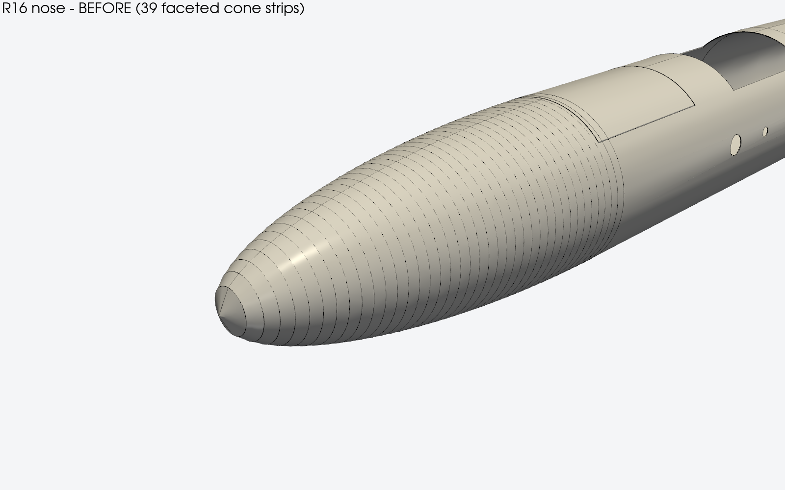
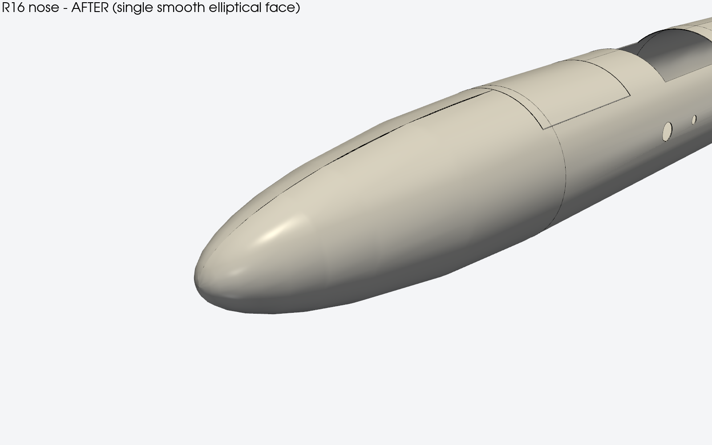

| Change | Detail |
|---|---|
| **Nose strips removed, shape unchanged** | The R16 nose (x 0–200) was 39 conical strips. Each strip corner lies exactly on the ellipse r(x) = 45·sqrt(1 − (1 − x/200)²), skin 0.33 mm (radial). The nose was rebuilt as that exact revolved ellipse, so each shell half now has one smooth outer and one smooth inner face (104 → 28 faces per half). Also rebuilt: `Hatch_Front` (its x 192–200 part) and `Fuselage_Seam_Strips` (0.30 mm under the skin). Boolean check: zero difference for x > 200.5. The only geometric change is the filled facet sag: 2.5 mm at the very tip (the first strip was a pointed cone), < 0.2 mm elsewhere, +0.08 g |
| **Pusher motor: Tarot 4008** | From the vendor STEP (85 g, Ø44.5 × 22, 4 mm shaft, M3 on Ø19 ×4 and Ø32 ×3). Replaced the `REF_MT4008_Envelope` placeholder |
| **`REF_Prop_Adapter_Pusher`** (provisional, 6061) | Ø20 × 3 flange on the rotor, Ø12 seat, 1/4 in shaft. Needed because the Tarot ships with a folding-prop clip, not a shaft for an APC 1/4 in bore |
| **Propellers** | APC Sport models from `build_props.py` (catalog mass matched at 1.35 g/cm³; geometry approximate, fine for mass/CG/clearance, not CFD). The six REF prop disks were removed |

| Position | Prop | Hand |
|---|---|---|
| Front_Boom_R, Rear_Boom_L | 10x3 LP10030 | STD, CCW from above |
| Front_Boom_L, Rear_Boom_R | 10x3 LP10030P | P, CW from above |
| Pusher | 13x8 LP13080P | P (pusher), cambered face forward |

Lift-prop rotation follows the ArduPilot Quad-X convention; swap STD/P if the flight controller layout differs. Lift props sit on the UM2807 bell top (z 8.2), centred on the M5 shaft.

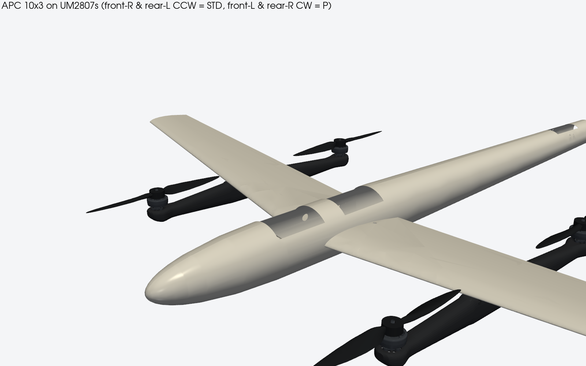

## R16.2 — pusher mount and prop nuts (November 17)

| Part | Change |
|---|---|
| `Pusher_Removable_Plate_6061` | **Not moved** (x 1102–1103.5, Ø49 × 1.5). The 4 holes on the 30 × 30 square were replaced by 4× Ø3.3 on the Tarot **Ø19 bolt circle**. The Ø12 centre hole is kept |
| `Tarot_4008_Pusher_Motor` | Moved 6.5 mm forward. Its base sits on the plate's aft face (x 1103.5); rotor top x 1122.5 |
| `Motor_Screws_M3x4_SHCS_Pusher` (new) | 4× ISO 4762 M3 × 4 from the plate's front face. They fill the 2 mm threads in the motor base; the tips end 0.5 mm into free space |
| `Pusher_Bonded_Collar_GFRP` | End-wall bore opened from Ø22 to Ø26 so the screw heads pass through it. Nothing else changed |
| `Fuselage_Shell_Right_GFRP` | About 7.5 × 7.5 mm notch at the trailing edge (x 1102.7–1110, z −3 to +4.5) for the motor wire-exit tab. The tab now points right (+Y), away from the L/R seam. Wires are not modelled |
| `REF_Prop_Adapter`, APC 13x8P | Moved 6.5 mm forward with the motor; prop mid-plane at x 1140 |
| `Prop_Nut_1-4in_Bullet_Pusher` (new) | Bullet nut on the adapter shaft |
| `UM2807_*` ×4 | Modelled M5 thread lengthened by 4.0 mm (5 pitches, copied from the existing helix so it stays continuous). Shaft top now z 25.7, leaving 5.8 mm of thread above the 10x3 hub. Nothing else on the motor changed |
| `Prop_Nut_M5_Bullet_*` ×4 (new) | M5 bullet prop nut (Ø11 flange, 8 mm hex, dome; 10 mm tall). Its 6.5 mm blind bore clears the shaft tip by 0.7 mm |

**Assembly sequence (pusher):**
1. Bond the collar into the fuselage shells (unchanged).
2. On the bench, bolt the Tarot to the plate with 4× M3 × 4 from the plate's front face, using blue threadlocker.
3. Bond the plate's front face to the collar's aft face (bond area: Ø26–Ø49 annulus).

The motor can still come off later. Through the tail hatch and the collar, a long 2.5 mm hex driver reaches the screw heads, which sit inside the Ø26 collar bore. The plate's old 30 × 30 holes pointed to a bolted, removable plate, but that cannot work: the motor base covers those holes, and the collar end wall never had matching holes.

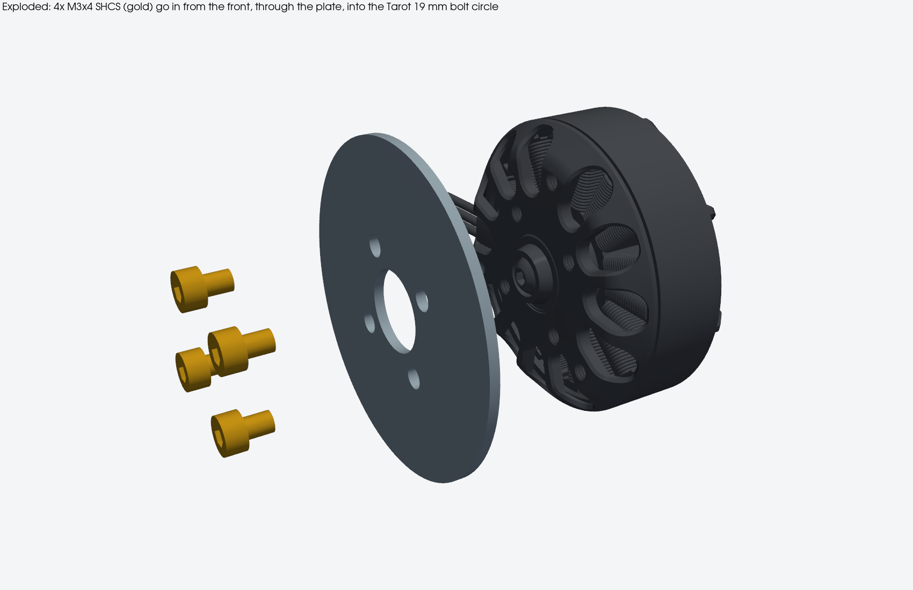
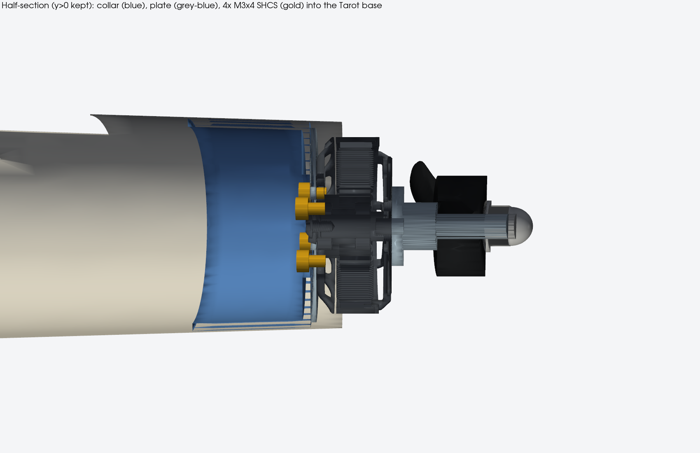
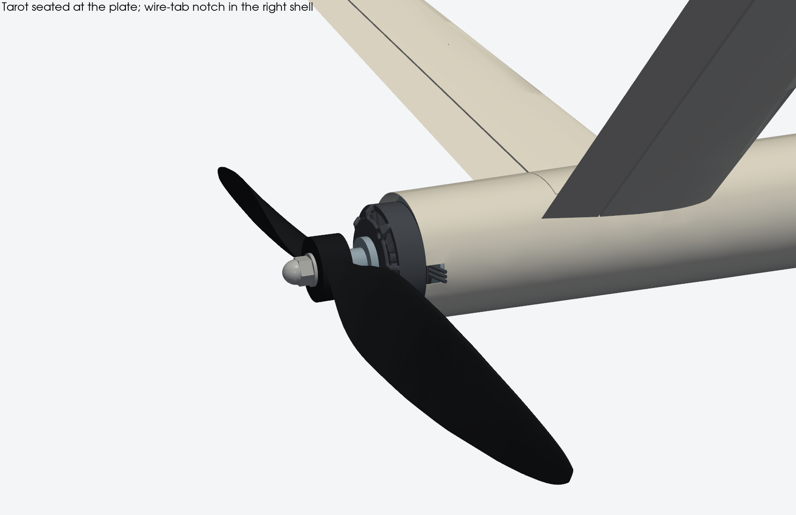
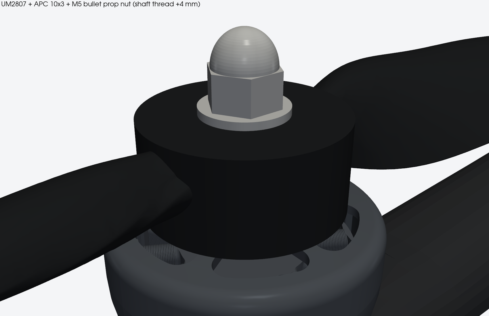

### Checks (R16.1 + R16.2)

- **Boolean overlap = 0.000 mm³** for plate/screws, collar/screws, collar/plate, plate/motor, nut/prop, nut/adapter and adapter/prop. Screws/motor = 12.6 mm³: the intended thread engagement (M3 shank in the Ø2.4 tapped holes).
- **Clearances:**

| Item | Nearest part | Clearance |
|---|---|---|
| Tarot motor | Right shell (with notch) | 1.2 mm |
| Tarot motor | Left shell | 3.7 mm |
| Tarot motor | Collar | 1.5 mm |
| Screw heads | Collar wall | 0.75 mm |
| M5 nuts | Shaft (radial) | 0.05 mm |
| 13x8 swept disk | Motor | 11.3 mm |
| 13x8 swept disk | Shell | 22.3 mm |
| 13x8 swept disk | Screws / plate / collar | 28–30 mm |
| 13x8 swept disk | Ruddervators | more than 30 mm |
| 10x3 swept disks | Motor screws / boom | 17.0 / 17.6 mm |
| 10x3 swept disks | Wing skin (front / rear) | 18.5 / 24.0 mm |

- The STEP was re-read after writing: 112 parts, all named, every changed part at its intended position.
- Not rebuilt in R16.1: `Frames_Lower` (x 135/170) and `Hatch_Rims` (x 187–200). They are internal and still follow the old facets, which sit 0.004 mm inside the new skin (bond line, not interference).

### Mass changes (R16.1 + R16.2)

| Item | Change |
|---|---|
| Lift props | 4 × 26.08 g = 104.3 g (R16 equipment assumed 4 × 20 g), so +24.3 g |
| Pusher group | 85 + 49.0 + 6.5 g (motor + 13x8 + adapter) at x ≈ 1124 (R16 allocated 148.9 g at x 1125) |
| Hardware | screws 2.9 g, nuts 1.7 + 4 × 1.0 g, plate 7.0 g, collar 22.4 g |

Estimate: about 3412 g, CG x ≈ 405 mm (NP 408.0, so the static margin is about 2 % MAC). `cg.json` has not been regenerated.

### Open items

1. **UM2807 shaft length:** check the real shaft before buying nuts. The model's thread was lengthened for the prop nut; if the real shaft is shorter, use a thinner hub, a spacer or a shorter nut.
2. **Pusher prop adapter:** provisional (REF). Choose a real bolt-on 1/4 in adapter for the Tarot rotor pattern.
3. **Pusher wire routing:** the right-shell notch is the exit; route the wires forward to the ESCs.
4. **Plate-to-collar bond:** pick the adhesive and surface prep. Thrust is in compression into the collar; torque is carried in shear.
5. **Regenerate `cg.json`** with the real prop and motor masses.

## R16.3 — nose camera (Z30) in a recessed cove (November 17)

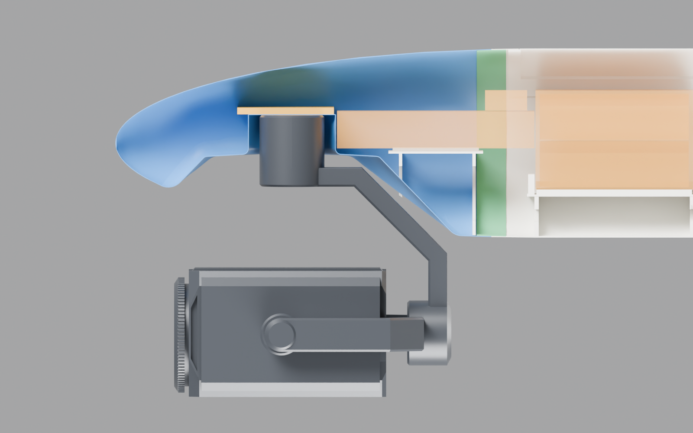

- **Camera:** Z30 camera + 3-axis gimbal STEP used for geometry. The mass is taken as **270 g** (the actual camera, documented but not modelled). Yaw axis is vertical at x 84, y 0; the gimbal top (mount face) is at z 13.4.
- **Position:** camera bottom at z −120.5 when level, which is 75.5 mm (3.0 in) below the belly line and 83.5 mm below the local nose skin. Pointing straight down it reaches z −147.2.
- **Cove:** a closed dome recess, revolved about the yaw axis, following the full swept envelope (360° yaw, pitch +30° to −120°) plus 5 mm. It has an R8 lip and R10–12 internal transitions, with no steps. The opening runs x 22–165 and reaches the waterline at x 55–70; the nose ahead of x 22 forms a chin. Sizing study: `renders/r16_3_z30_nose_options.png` (3.0 in vs 4.3 in).
- **Removed:** `REF_Camera_AI_PROVISIONAL`. **Trimmed:** the x 135 lower frame. **Added:** `REF_Z30_Camera_Gimbal` and `REF_Z30_Swept_Envelope` (reference, no structural mass).
- **Drag** (hand estimate, Cd 1.0 × 1.25, not tested): 1.5–2.3 N at 20 m/s cruise, which is about 25–35 % of the 6.62 N cruise thrust. 7.6–11.2 N at 44.6 m/s, giving about 1 N·m at the mount. Structural margins are large; endurance, trim and the gimbal's airspeed rating are the real issues.

## R16.4 — removable nose module (November 17)

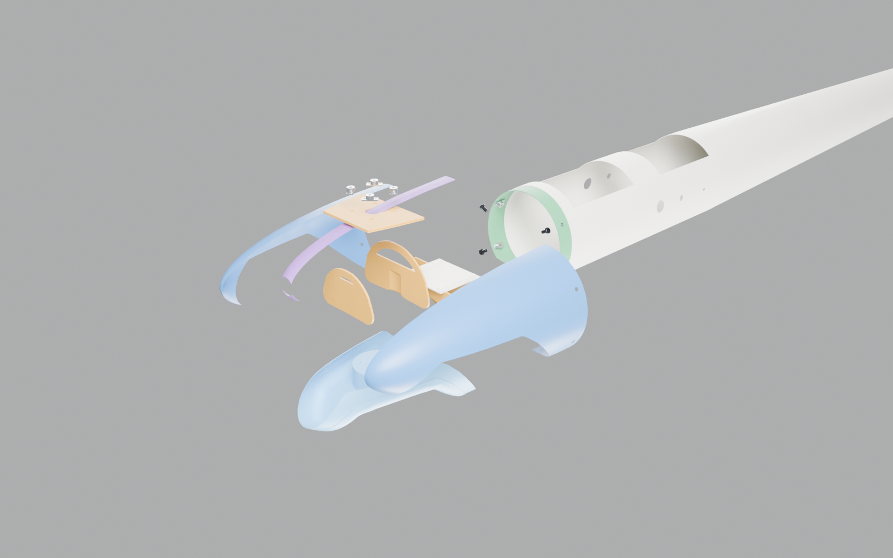
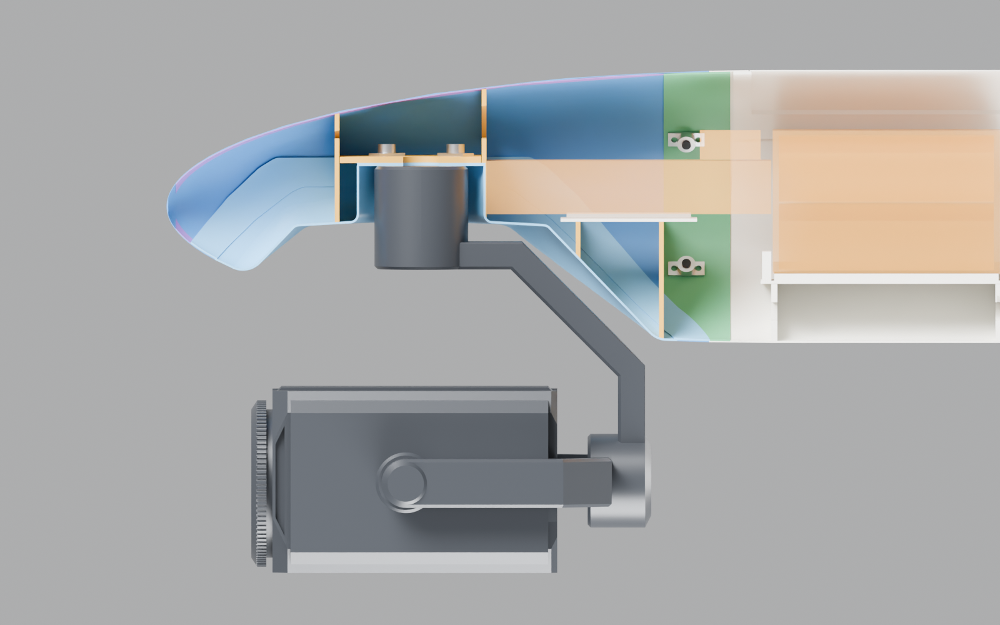

**Design decision: screw-retained, removable nose.** The nose module (x 0–179) is a line-replaceable unit (LRU), retained by 4 × M3 screws into captive nutplates instead of a permanent bond. It is the most damage-prone part of the airframe: it makes first contact in a nose-down or off-centre landing, and it carries the exposed cove skin. It also holds the most-serviced items: the camera mount, avionics deck and flight controller. With a screwed joint, a customer or repair team can remove it with a 2 mm hex key, service those items or fit a spare nose, without cutting the shell or replacing the fuselage. Cost: about +10 g of hardware and a harness disconnect at the joint.

| Part | Material | Station x | Mass (g) | Notes |
|---|---|---|---|---|
| `Nose_Shell_Left/Right_GFRP` | GFRP 0.33 | 0–179 | 7.2 / 7.0 | L/R halves; opening edge 4.5–13.5 mm outside the cove |
| `Nose_Cove_Liner_GFRP` | GFRP 0.66 | 8–179 | 24.5 | Cove dome + R8 lip + 10 mm flange under the shells (bridges the bottom seam) + roof doubler |
| `Nose_Seam_Strips_GFRP` | GFRP 0.30 × 12 | 3–164 | 1.1 | Top seam + chin |
| `Nose_Frame_NF1_G10` | G10 1.5 | 55.5–57 | 4.9 | Front wall of the shelf box |
| `Nose_Frame_NF2_G10` | G10 1.5 | 104–105.5 | 6.3 | Rear wall of the shelf box, notched round the neck; lightening hole routes the camera cable |
| `Nose_Frame_NF3_G10` | G10 1.5 | 135–136.5 | 3.3 | Replaces the x 135 sliver; deck seat at z −5 |
| `Nose_Frame_NF4_G10` | G10 1.5 | 162.5–164 | 7.1 | Replaces F170 (7.5 mm forward); deck seat; axial stop for the band |
| `Camera_Shelf_G10` | G10 2.0 | 57.2–103.8 | 10.3 | On the roof doubler; mount pattern **4 × M3 on Ø32 PCD at 45° + Ø12 cable hole** |
| `Camera_Mount_Nutplates_M3` ×4 | Steel | shelf top | 3.7 | 2-lug, self-locking |
| `Nose_Joiner_Band_GFRP` | GFRP 0.6 | 164–186 | 5.8 | Bonded in the fuselage (179–186); spigot 164–179 slides into the nose |
| `Nose_Joint_Nutplates_M3` ×4 | Steel | 171.5 | 3.7 | On the band's inner face; serviceable with the nose off |
| `Nose_Joint_Screws_M3x6_ISO7380` ×4 | Steel A2 | 171.5 | 2.4 | Button head, 2 mm hex, at ±60° and ±120° from top |

Replaced in place: `Camera_Shelf_G10` (was 3 mm), `Nose_Joiner_Band_GFRP` and `Frames_Lower_and_Battery_Saddles_GFRP` (x 135 and x 170 frames removed; it now starts at the x 200 saddle). Removed: the R16.3 one-piece `Nose_Shell_GFRP`.

Manufacturing and assembly, including nutplate installation: [`manufacturing/NOSE_MODULE_MANUFACTURING.md`](../../manufacturing/NOSE_MODULE_MANUFACTURING.md).

### Checks (R16.3 + R16.4)

- **Overlaps:** 102 part pairs within 0.5 mm of a new part are all 0.000 mm³, except intended thread engagement (joint screws/nutplates 34.6 mm³) and three bond-line contacts under 0.1 mm³ (`clearance_r16_4.json`).
- **Gimbal sweep** (full yaw, pitch −120° to +30°), minimum clearance:

| Part | Clearance (mm) |
|---|---|
| Liner | 5.1 |
| NF2 | 4.9, at the neck top above the roof (the roof is between) |
| NF1 | 6.1 |
| REF FC | 6.1 |
| NF3 | 9.2 |
| NF4 | 10.0 |
| Shells | 12.9 |
| Avionics deck | 13.3 |

  The yaw-motor top seats on the roof (mount face).
- **Landing station:** the camera's lowest point is z −147, about 153 mm above the station floor. Not yet checked against the station STEP.

### Mass changes (R16.3 + R16.4)

- R16.3: camera +270 g at x 86.5; nose skin/shelf/band +18 g net.
- R16.4: nose module structure + hardware about 87 g, **+38.5 g** vs R16.3.
- Estimate: **about 3738 g, CG x ≈ 378** (target 394.4, NP 408.0). `cg.json` is not regenerated.

### Open items (R16.3 + R16.4)

1. **FC length vs NF2:** the REF Cube starts at x 105.5, where NF2 ends (touching). Confirm the real FC and carrier.
2. **Harness disconnect** for the FC and camera at the nose joint.
3. **Real camera mount pattern:** the nutplates can move up to about a Ø38 PCD.
4. **Camera gimbal airspeed rating** at 20–45 m/s; drag numbers to Aero/Controls.
5. **Landing-station clearance check** with the station STEP.
6. **Layup zones** (4 plies at the shell opening and aft 20 mm) are in the process notes, not modelled as thickness.

## R16.5 — V-tail root block, root fairings and wing pin (November 18)

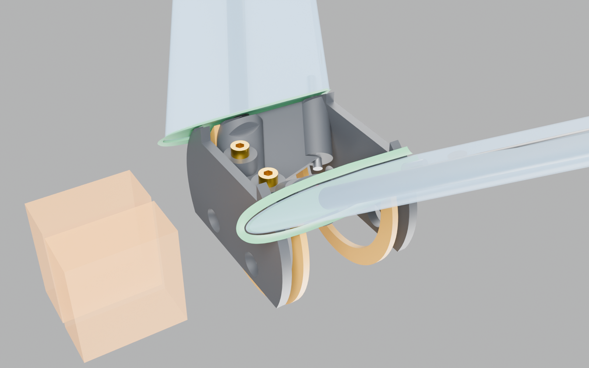
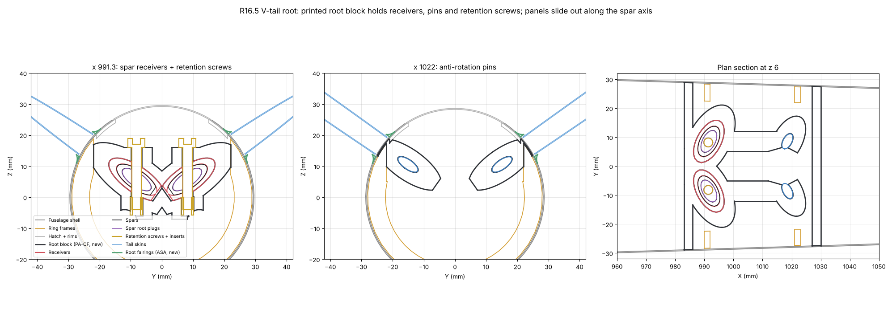

**Why.** In R16.4, nothing carried the V-tail loads into the airframe:
- The V-tail receivers floated: 2.0 mm to F990 and 5.5 mm to the shell.
- The anti-rotation pins sat only in holes in the 0.33 mm skin.
- There was no spanwise retention.
- Each pin was **23.5° off the swept spar axis**, so a panel could not slide in or out.

The wing anti-rotation pin engaged the fuselage only through the 2 mm side rail. Wing and V-tail roots had zero gap and no fairing.

| Part | Change |
|---|---|
| `VTail_Root_Block_PA-CF_Fuselage` (new) | Printed CF-nylon, x 983–1030. Receiver and pin bosses, radial webs in each panel plane, front and aft plates, screw bosses, two Ø8 pushrod/cable channels. Bonded to the shell and to F990/F1021 (captured in notches). 20.5 g at 0.95 g/cm³ effective |
| `VTail_Root_Receivers_GFRP_Fuselage` | Extended to the centreline: 23 mm spar engagement (was 17.5) |
| `VTail_AntiRotation_Pin_D3_VTail_R/L` | Now **parallel to the spar axis**; about 12 mm engagement in the block. Old shell and core holes filled, new ones drilled |
| `VTail_Retention_Screws_M3x20_ISO4762` ×2, `VTail_Retention_Inserts_M3_Brass` ×2, `VTail_Spar_Root_Plug_6061_VTail_R/L` (new) | One vertical screw per panel, through block → receiver → spar → plug into a heat-set insert. Reached through the tail hatch |
| V-tail fixed skin/core, diaphragm, ruddervator | 0.5 mm root gap (1.0 mm at the ruddervator); diaphragm rebuilt 1 mm thick at r + 0.5…1.5; ruddervator LE bevelled 27° about the hinge (R16.4 clashed at ±25°) |
| `VTail_Root_Fairings_ASA_Fuselage` (new) | Printed R3.5 fillet on the fixed surface only (x ≤ 1031), 0.5 mm reveal, clear of the tail hatch |
| `Wing_Root_Fairings_ASA_Fuselage` (new) | Printed R6 fillet round the LE to 95 % chord; the wing slides out under its lip |
| Wing skin, root diaphragms | 0.5 mm root gap; diaphragm edge trimmed so it clears the fairing during slide-out |
| `Wing_Pin_Bushing_Pads_G10_Fuselage` (new), `Wing_AntiRotation_Pin_D3_Wing_R/L` | 4 mm G10 pad bonded inside each side rail; pins extended to y ±36.5. Fuselage engagement 5.5 mm (was 2 mm) |

R8 (wing) and R6 (V-tail) fairings were planned; R6 and R3.5 are the largest radii the CAD kernel would build on these junctions.

**To remove a V-tail panel:** open the tail hatch, take out 1 M3 screw (2.5 mm hex), and slide the panel out along its spar axis.

### Checks (R16.5)

- **Overlaps:** 201 pairs within 0.5 mm of a new or changed part. All 0.000 mm³ except the intended screw/insert thread engagement and a receiver/shell bond line (`clearance_r16_5.json`).
- **Motion:**
  - V-tail panel slid 0–30 mm along the spar axis: 0 overlap.
  - Ruddervator ±25°: 0.
  - Wing slid 0–40 mm along +y: 0.
- **Seated on the landing station** (`RescU_R16_5_Seated_on_Landing_Station.step.zip`, 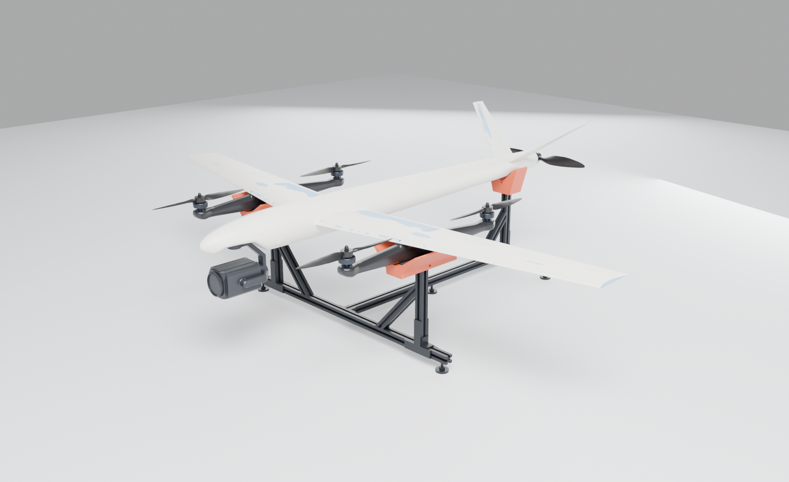):
  - 0 overlaps; only the three EVA pads touch.
  - Boom/cradle gap 3.0 mm, tail shell/cradle 2.7 mm.
  - Nose camera at 179.5 mm above the floor when level, 152 mm pointing down; its sweep is 224 mm from the nearest station part.
  - The station body is the 17-body model in `cad/landing_station`. The Rev B STEP (same cradles, pads and heights) is to be added.

### Mass (R16.5)

+29 g (block 20.5, fairings 3.0, pads 2.4, screws and inserts 3.9, plugs 0.7, receivers +0.5, diaphragms −1.9). Estimate **about 3768 g, CG x ≈ 382** (target 394.4).

### Open items (R16.5)

1. Proof-load one V-tail panel (about 25 N at the MAC) on the printed block before flight.
2. Real pushrod routing (the Ø8 channels are placeholders).
3. Seal tape spec for the root gaps.
4. Swap in the landing station Rev B STEP for the seated assembly.
