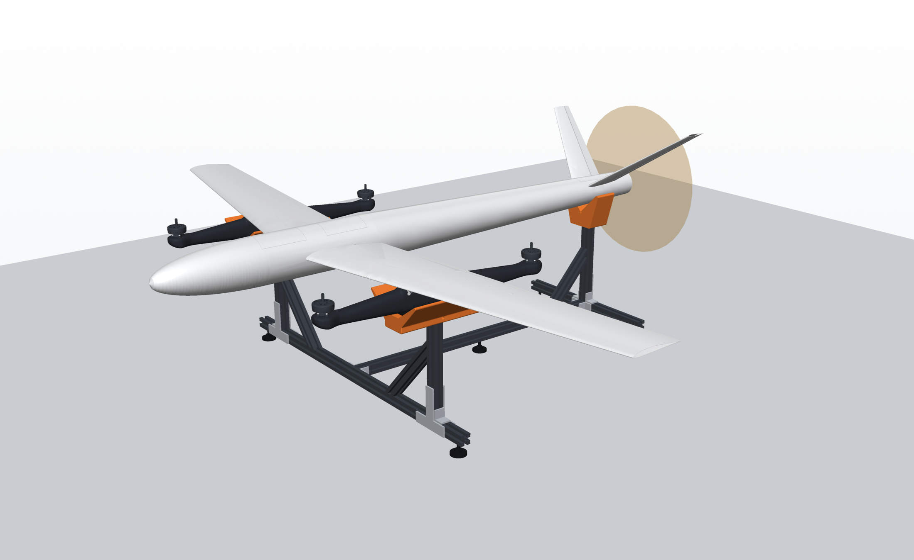
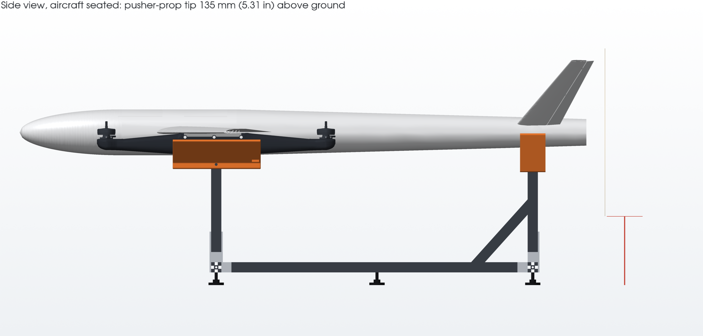
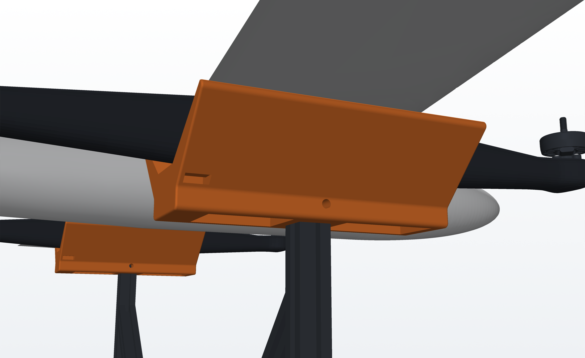
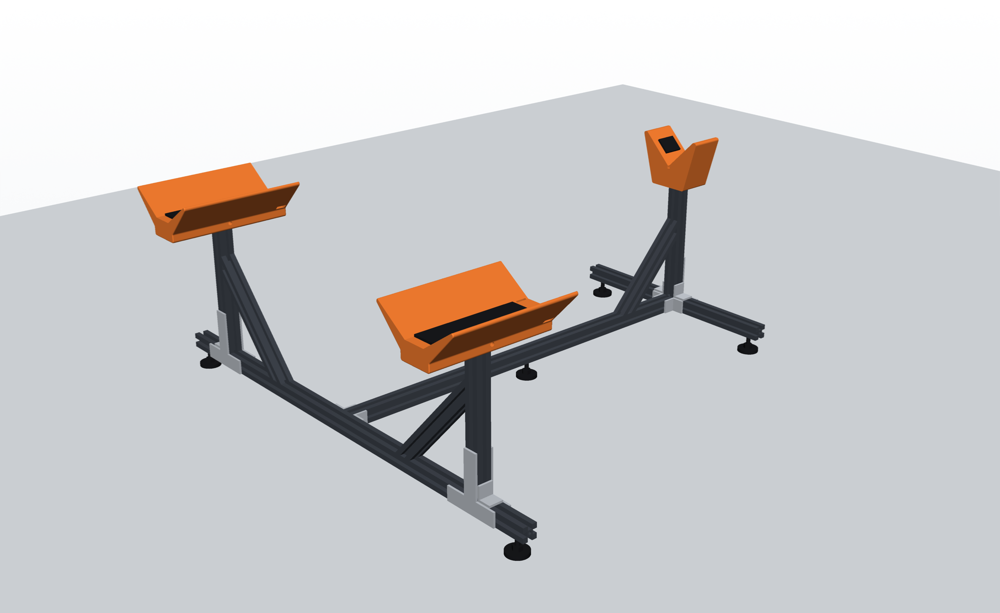

# RescU Landing Station — Manufacturing Plan

Nov 15, 2026 · Diego. Working copy also kept as a Claude doc ("RescU Landing Station — Manufacturing Plan"). CAD: [`cad/landing_station/`](../cad/landing_station/).

## 1. Overview

The landing station replaces the R16 landing gear. The aircraft flies with no legs; it lands vertically onto the station, where two flared cradles catch the motor booms at mid-boom and a V-rest catches the tail. When the pusher prop is parked or stopped, nothing on the aircraft touches the ground.

The frame is 2020 T-slot aluminium on five leveling feet. The three cradles are 3D printed, and the aircraft only touches 3 mm EVA foam pads.

| Item | Value |
| --- | --- |
| Footprint (rails) | 640 mm long × 700 mm wide |
| Fuselage centreline when seated | 300 mm above ground |
| Boom bottoms when seated | 257 mm above ground |
| Pusher-prop tip to ground | 134.9 mm (5.31 in) — requirement ≥ 127 mm (5 in) |
| Weight share when seated | boom cradles ≈ 96 %, tail rest ≈ 4 % (CG x 406.6) |
| Landing capture range | ±45 mm sideways at the booms, ±40 mm at the tail, ±3.8° heading, ±30 mm fore/aft |
| Station mass (estimate) | ≈ 2.3 kg |

**Coordinates.** All dimensions use the aircraft's X (aft from nose) and Y (right). Z is measured up from the ground; the aircraft CAD sits at Z + 300 mm.

**CAD files.** `RescU_Landing_Station.step` (station only) and `STL/` (printable parts, already in print orientation). The aircraft is `cad/r16/RescU_R16_Full_Aircraft.step.zip` with the landing gear removed.

## 2. Design rules and how they were checked

Every rule below was checked against the R16 CAD with the aircraft seated on the station model.

| Rule | How the station meets it | Check result |
| --- | --- | --- |
| Pusher prop ≥ 5 in (127 mm) above ground | Cradle heights put the fuselage centreline at 300 mm | Prop tip at 134.9 mm (5.31 in) |
| Nothing under a lift-prop disk | Cradles sit in the x 297–473 gap between the front and rear prop disks; rails, posts and braces sit at x 385, x 1005 or on the centreline | Closest station point is 1.9 mm outside a disk edge (plan view) |
| Landing load goes into structure, not skin | Boom cradles bear on the flat boom bottom at x 312–448, directly under the motor-rib / spar joint; the tail V bears on the fuselage at the F990 ring frame | — |
| Aircraft touches only the foam pads | Pads sized to the boom bottom (flat at z −43 from x 310–450) and to the tail radius at x 990 (29.6 mm) | 0 overlaps; pads touch with 0.00 mm gap; no other aircraft part within 2 mm of the station |
| Self-centring on landing | Boom channels flare 55° from vertical to a 122 mm wide mouth; tail V is 90° with an 88 mm mouth | Capture ±45 mm at booms, ±40 mm at tail, ±3.8° heading |
| Stable when seated | The 136 mm long boom pads span the CG (x 406.6 now, x 394.4 at the target CG) | Tail carries ≈ 4 % now, ≈ 2 % at the target CG |
| Printable without supports | All three cradles are constant-section extrusions printed standing on an end face | Largest bridge 34 mm (lightening pocket) |

**Aircraft impact:** none beyond removing the gear. R16 is 3387 g, CG x 406.6, static margin +1.0 % MAC.

The station itself doesn't need a folding or parked prop. For landings away from the station, parking the pusher horizontally (with a prop saver as backup) is still recommended.

## 3. Bill of materials

### 3a. 2020 aluminium extrusion — cut list

Use 20 × 20 mm T-slot extrusion (6063-T5, black anodised looks best).

| ID | Part | Qty | Length (mm) | End prep |
| --- | --- | --- | --- | --- |
| F1 | Front cross rail (along Y at x 385) | 1 | 700 | Square both ends |
| F2 | Spine (along X on centreline) | 1 | 600 | Square both ends |
| F3 | Rear cross rail (along Y at x 1005) | 1 | 340 | Square both ends |
| P1 | Boom post | 2 | 201 | Square; tap top-end centre bore M5 × 15 deep |
| P2 | Tail post | 1 | 195 | Square; tap top-end centre bore M5 × 15 deep |
| B1 | Boom brace | 2 | 194.0 long point / 154.0 short point | 45° miter both ends, opposed |
| B2 | Tail brace | 1 | 165.8 long point / 125.8 short point | 45° miter both ends, opposed |

Total: 2.79 m. Nests into three 1000 mm sticks with 3 mm kerfs:

- **Stick 1:** F1 700 + P1 201
- **Stick 2:** F2 600 + F3 340
- **Stick 3:** P1 201 + P2 195 + B1 194 + B1 194 + B2 166 (≈ 965 mm with kerfs)

### 3b. Printed parts

Print in PETG, or ASA if the station will live outdoors.

| ID | Part | Qty | File | Size (mm) | Solid volume | Est. printed mass |
| --- | --- | --- | --- | --- | --- | --- |
| C1 | Boom cradle (same part both sides) | 2 | `STL/Cradle_Boom_PETG_print_x2.stl` | 172 × 126.5 × 58 | 308 cm³ | ≈ 210 g each |
| C2 | Tail V-rest | 1 | `STL/Cradle_Tail_PETG_print_x1.stl` | 50 × 100 × 76 | 189 cm³ | ≈ 130 g |

### 3c. Hardware and soft goods

| Item | Qty | Use |
| --- | --- | --- |
| 2020 T-shaped joining plate, 5-hole | 5 | Front and back faces of each boom post, back face of the tail post |
| 2020 L corner bracket (20 × 20) | 8 | Outboard face of each boom post (2), both sides of the tail post (2), spine-to-rail inside corners (4) |
| 2020 135° (45° brace) bracket | 6 | Both ends of each brace (not modelled in the CAD) |
| M5 × 10 button-head screw | 53 | Plates and brackets |
| M5 × 20 button-head screw | 7 | Cradle centre screws (3); boom-cradle side screws (4) |
| M5 drop-in T-nut (2020) | 62 | Plates, brackets, cradle side screws, leveling feet; buy a 100-pack |
| M5 leveling foot, ≈ 30 mm pad | 5 | Rail ends (4) plus spine middle (1) |
| EVA foam, 3 mm, adhesive-backed | 1 sheet | Boom pads 2 × (136 × 30 mm); tail pads 2 × (30 × 24 mm) |
| ½ in hook-and-loop strap, ≈ 400 mm | 2 | Hold-down around each boom, through the cradle slots |
| Blue thread-locker | — | Cradle centre screws |

## 4. Printed parts

**Orientation.** The STLs are already oriented: each cradle stands on one end face, aircraft X axis up. Every cradle is a constant cross-section, so the 55° flared walls and 45° V faces print vertically with no supports. The landing load bends the part within the layer plane (its strong direction).

| Setting | Boom cradle C1 | Tail V-rest C2 |
| --- | --- | --- |
| Material | PETG (ASA if stored outdoors) | same |
| Nozzle / layer height | 0.4 mm / 0.24 mm (0.6 mm at 0.3 mm is fine and faster) | same |
| Walls / top & bottom | 4 walls / 6 layers | 4 walls / 6 layers |
| Infill | 25 % gyroid | 30 % gyroid |
| Bed adhesion | 8 mm brim (part is 172 mm tall) | none needed |
| Supports | none | none |
| Est. print time | ≈ 10–14 h each (0.4 mm nozzle) | ≈ 6–8 h |

Print times and masses are slicer-dependent estimates; check them in your slicer.

**Post-processing (each part):**

1. Remove the brim and deburr the edges, especially the channel rim the boom slides over.
2. Test-fit the post pocket on a 2020 offcut (drawn 20.3 mm square, slip fit). If it binds, sand it; if your printer runs tight, reprint at 100.5 % in X/Y.
3. Clean up the M5 holes with a 5.5 mm drill (side holes and the centre hole in the floor).
4. Degrease the pad areas with isopropyl alcohol and apply the 3 mm EVA pads. Boom pad: 136 × 30 mm, centred on the floor. Tail pads: 30 × 24 mm on each V face, starting at the forward face (x 990). Press 30 s; let the adhesive cure 24 h.

Apply the boom pads after the cradle is screwed to its post: the centre screw head sits under the pad.

## 5. Frame fabrication

The easiest route is to order the extrusion cut to length (and end-tapped). To make it in the shop:

1. **Cut.** Miter saw with a non-ferrous carbide blade, or a horizontal band saw. Clamp firmly, cut slowly, use cutting wax. Length ±0.5 mm; posts square to ±0.25° (post squareness sets cradle level).
2. **Miter the braces.** 45°; flip the piece for the second cut so the miters are opposed. Long point to long point: B1 = 194.0 mm, B2 = 165.8 mm. Dry-fit against a post-and-rail corner and trim if needed.
3. **Tap.** Top-end centre bore of both boom posts and the tail post to M5, 15 mm deep (bore is already Ø4.2). Cutting fluid; back the tap out every turn.
4. **Deburr** all cut ends and slot openings; blow out chips.
5. **Mark** each piece with its ID (F1–F3, P1, P2, B1, B2).

## 6. Assembly sequence

Work on a flat floor or bench. Leave fasteners finger-tight until step 9.

1. **Base T.** Butt the spine (F2) front end against the back face of F1 at its midpoint; fix with two L brackets. Repeat at the rear: spine end against the front face of F3 at its midpoint.
2. **Feet.** M5 T-nuts in the bottom slots; five leveling feet 20 mm in from each end of F1 and F3 (x 385, y ±330 and x 1005, y ±150), plus one under the spine at x 700. Set all to ≈ 20 mm under the rail.
3. **Boom posts.** P1 on top of F1, centres 265 mm each side of the centreline (530 mm apart). T-plate on front and back faces, L bracket on the outboard face.
4. **Boom braces.** B1 between each boom post's inboard face and the top of F1 (foot ≈ 140 mm inboard of the post centre). 135° brackets both ends.
5. **Tail post.** P2 on top of F3 at y = 0. T-plate on its back face, L bracket each side.
6. **Tail brace.** B2 from the front face of P2 down onto the spine. 135° brackets both ends.
7. **Boom cradles.** Press onto each boom post, strap slots toward the tail. M5 × 20 centre screw (thread-locker) into the post end tap, then two M5 × 20 side screws into T-nuts.
8. **Tail rest.** Press C2 onto the tail post, V on the centreline, M5 × 20 centre screw.
9. **Square and tighten.** Check diagonals and post verticality (section 7). Tighten every M5 to ≈ 4 N·m (or the bracket supplier's value).
10. **Pads.** Apply EVA pads (section 4, step 4). Fit the straps through the cradle slots.

## 7. Inspection and fit check

| # | Check | Spec | How |
| --- | --- | --- | --- |
| 1 | Station level | ≤ 0.5° both ways | Level on front rail and spine; adjust feet |
| 2 | Frame square | Diagonals equal within 2 mm | Tape measure across the base T |
| 3 | Posts vertical | ≤ 0.5° | Square or level on two faces of each post |
| 4 | Boom pad top height | **257 ±1 mm** both sides, equal within 1 mm | Height gauge at the pad centre |
| 5 | Boom cradle spacing | 530 ±1 mm centre to centre | Channel centre to channel centre |
| 6 | Tail rest position | Centreline ±1 mm; 620 ±2 mm aft of boom-cradle centres | Rule from the post centres |
| 7 | Tail V vertex height (printed, under pads) | 253.9 ±1 mm | Rule at the vertex slot |
| 8 | Fit: booms | Both booms flat, no rocking; 0.5 mm feeler won't enter under either pad end | Seat the aircraft by hand |
| 9 | Fit: tail | Fuselage touches both V pads | Look along the V |
| 10 | Fit: nothing else touches | Only the four pads touch the aircraft | Visual check all round |
| 11 | **Prop clearance** | **Pusher tip ≥ 127 mm above ground (design 135 mm)** | Turn one blade straight down and measure |
| 12 | Self-centring | Lowered 40 mm off-centre and 3° off heading slides into the seat | Repeat both sides |

Record measured values in the engineering notebook. If check 4 or 11 fails, adjust the feet first; then shim under the cradle or re-cut the post.

## 8. Operation, transport and open items

**Landing on the station**

- **Accuracy needed:** ±40 mm horizontally and ±3.8° heading at touchdown. Standard GPS hover (≈ ±0.5–1 m) is not enough: use RTK GPS or a vision / IR precision-landing beacon, landing heading with the tail toward the tail rest.
- **Final descent:** ≤ 0.3 m/s over the last 0.5 m; disarm on touchdown detection.
- **Pusher prop:** stopped (parked horizontally if implemented) before the vertical descent; 135 mm clearance even with a blade straight down.
- **Hold-down:** outdoors, strap each boom through the cradle slots aft of the wing trailing edge. In wind, weigh down or stake the base (station ≈ 2.3 kg vs aircraft 3.4 kg).

**Transport.** Remove the three cradles (centre screw + two side screws each) and unbolt posts and braces; packs flat at ≈ 700 × 600 × 60 mm.

**Open items**

1. Choose the precision-landing system (RTK or beacon); a beacon mount on the spine is not modelled yet.
2. Drop-test the cradles from 100 mm; check PETG for cracking and pads for bottoming out. Go to 5 mm EVA if needed (+2 mm everywhere; prop clearance 137 mm).
3. Outdoors: print in ASA and use stainless fasteners.
4. Optional later: charging contacts on the boom pads, battery-swap position on the spine.
